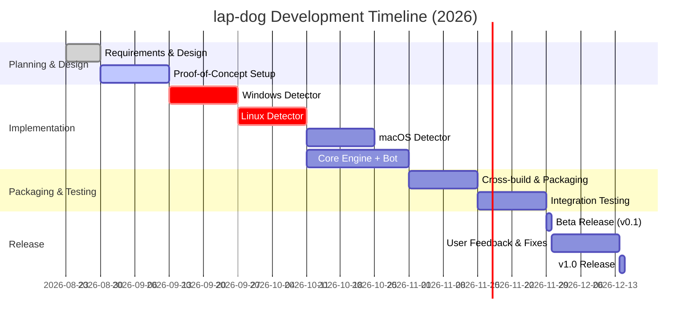

# Cross-Platform Laptop Security Agent (Project **lap-dog**) – Product Requirements

## Executive Summary

We propose **lap-dog**, a lightweight, cross-platform (Windows, Linux, macOS) agent that monitors laptop login/authentication events and sends real-time alerts via a Telegram bot when unusual access occurs while the owner is away.  This PRD covers user needs, architectural design, OS-specific data sources, security/event normalization, alert logic, reliability, deployment and hardening guidelines, and a phased implementation plan.  lap-dog will run as a background service/daemon on the user’s machine, watch kernel/authentication logs (Windows Event Log, Linux audit or journald, macOS unified logs), normalize these into a common **SecurityEvent** schema (with fields like timestamp, event type, user, source, severity), and apply rules (failed login, success login, unlock, USB insert, etc) to decide when to alert.  Alerts are sent over Telegram using a dedicated bot token (via HTTPS) with deduplication/rate-limiting and offline queueing if network is down.  The agent stores minimal state (event IDs, device ID) locally in an encrypted config or SQLite.  We compare a direct “Device→Telegram” approach vs a “Device→Server→Telegram” relay.  The document outlines threat scenarios (network loss, token theft, agent disabling), privacy considerations, packaging (OS-specific service installers or binaries), testing strategies, and a target timeline.  

Key design highlights include:

- **OS Event Sources** – Use built-in secure logs. For Windows, monitor Security log events (4624=login success, 4625=login failure, 4800=lock, 4801=unlock, plus RDP session events). For Linux, use `auditd` or systemd-journald/PAM logs (e.g. `USER_AUTH`/`USER_LOGIN` events). For macOS, use the Unified Logging system to capture login/logout/auth failures. 
- **Event Normalization** – Define a `SecurityEvent` schema (fields: timestamp, deviceID, OS, eventType, username, source IP, severity, etc).  Map all OS-specific events to a few types: e.g. *LOGIN_SUCCESS*, *LOGIN_FAILURE*, *UNLOCK*, *REMOTE_LOGIN*, *USB_INSERT*, etc, with severity (INFO, WARNING, CRITICAL).
- **Detection Rules** – Trigger alerts on criteria such as failed login attempts, successful logins, workstation unlocks, remote (e.g. SSH/RDP) logins, USB insertion, or multiple failures in short time.  Include an **“away mode”** toggle so that alerts only fire when user is away (e.g. laptop locked). 
- **Alerting & Queuing** – Use the Telegram Bot API (HTTPS) for notifications.  Adopt an offline-first design: events are queued locally (e.g. SQLite or file) if no network, and retried.  Deduplicate repeated events and apply rate-limits.
- **Security & Configuration** – Store the Telegram bot token securely (e.g. encrypted config or environment, not plaintext).  Consider two modes: Option A (Direct Device→Telegram) vs Option B (via a small relay server).  Use an immutable **Device ID** to identify the laptop in messages. 
- **Threat Model & Hardening** – Assume an attacker with physical access may try to disable the agent or steal the token.  We mitigate by running the agent as a low-level service/daemon with minimal privileges, verifying data integrity (e.g. write-once logs), and isolating token (possibly moving to a server).  Plan for failures (network down, Telegram unavailability) and outline recovery strategies. 
- **Packaging & Deployment** – Build native installers/bundles: a Windows Service (MSI/EXE installer), a Linux daemon (systemd unit + package), and a macOS launch agent (pkg or homebrew).  Use a cross-compiled Go or Rust binary to ease multi-OS support.  Ensure updates (auto or manual) and a configuration UI/CLI. 
- **Testing & CI** – Provide unit and integration tests (simulate events), continuous integration for cross-builds, and telemetry/logging for remote diagnostics.  Include use-case testing (e.g. lost network, suspended laptop).

A timeline (Mermaid Gantt) is provided below, and key comparisons (Direct vs Relay, Language choices, Storage backends) are summarized in tables.

## 1. Background and Scope

**Target User:** Personal laptop owners concerned about unauthorized physical or remote access when away.  
**Goal:** Provide immediate alerts for suspicious access attempts.  
**Assumptions:** User has a Telegram account; minimal trust in network (HTTPS only); device offline periods possible; unspecified budget.  
**Out of Scope:** Complex SIEM integration, AI analysis, multi-user enterprise deployment.  

## 2. Use Cases and Requirements

- **UC1 – Failed Login Alert:** If the laptop is locked/away and someone enters a wrong password, send a "🔒 Failed Login Attempt" alert via Telegram with user/host info.
- **UC2 – Successful Login Alert:** If a login (or unlock) occurs while away, send "🔴 Login Success – potential breach" alert.
- **UC3 – Remote Access Alert:** If remote login (SSH/RDP) to the laptop happens unexpectedly, alert.
- **UC4 – Multiple Failures:** If >N failures in short time, escalate and alert as possible brute-force.
- **UC5 – Unusual USB Insert:** (Optional) If a USB is inserted when away, alert for possible compromise.
- **UC6 – User Commands:** From Telegram, user can set /away and /back to toggle monitoring, or /status to get current stats.
- **Non-Functional:** Agent must be lightweight, resilient to offline/network issues, secure (do not leak token), respect privacy (logs only security events), easily installed on each OS, and reliable.

## 3. OS-Specific Event Sources

### Windows

- **Windows Event Log (Security channel)** – Use the Security event log (via ETW/Win32 API). Key Event IDs (Audit Logon):
  - *4624 (Success)*: Successful logon.  
  - *4625 (Failure)*: Failed logon attempt.  
  - *4800/4801*: Workstation lock/unlock.  
  - *4778/4779*: RDP session connect/disconnect (if remote desktop is enabled).  
  - *Remote/Network logon types* (LogonType in 4624/4625): e.g. 3 (network) vs 7 (unlock).  
  - *USB insertion*: Windows raises events (Event ID 20001-20003 in Microsoft-Windows-Partition) or can watch Windows DevLog for new devices. (May require extra config; optional detection).
- **APIs:** The Windows API (`EvtSubscribe`, `Evtx`, or `wevtapi`) or use .NET/C# `EventLog`, or Go “x/sys/windows/svc/eventlog” packages.

### Linux

- **Audit Framework (auditd)** – If enabled, `/var/log/audit/audit.log` contains records. Look for `type=USER_AUTH` (authentication attempt) and `type=USER_LOGIN` (successful login) records.  
- **systemd-journald / syslog** – On systems with systemd, use `journalctl`: filter by `_TRANSPORT=audit` or `SYSLOG_FACILITY=10`/`4` for auth.  Failures appear in `/var/log/auth.log` (Debian/Ubuntu) or `/var/log/secure` (RHEL). SSHD records “Failed password” and “Accepted password” messages. Examples:
  - `journalctl -q _AUDIT_TYPE=USER_LOGIN` (login) or filter `pam_unix(sshd:auth): authentication failure` messages.
  - The systemd-logind service also logs new session creation (e.g. “New session of user X”).
- **PAM Hooks:** Alternatively, a PAM module can send alerts for auth events.
- **APIs:** Use Linux APIs like `libaudit` (via [go-libaudit](https://github.com/elastic/go-libaudit)) or `go-systemd` libraries to read the journal. For simple setups, parsing `/var/log/auth.log` or `journalctl` output (JSON mode) may suffice.

### macOS

- **Unified Logging (os_log)** – Modern macOS (10.12+) uses the Unified Logging system. Relevant predicates for login/auth events include:
  - loginwindow/sessionDidLogin, sshd, sudo, su, securityd messages. The Elastic integration notes “Authentication logs: User login/logout events, authentication failures” using filters like `process contains "loginwindow" and composedMessage contains "sessionDidLogin"`.
  - macOS also logs unlock events (`loginwindow` processes).  
- **Console Access:** Use the `log` command or APIs like `os_log`/`asl` to query.  
- **APIs:** Apple’s [Unified Logging](https://developer.apple.com/documentation/os/logging) with `OSLog`, or run `log stream` commands via subprocess. A helper (written in Swift/Obj-C) could feed logs to our agent.

### Summary Table: Event Sources

| Platform | Key Sources                   | Example Events/IDs                                |
|----------|-------------------------------|---------------------------------------------------|
| **Windows** | Security Event Log (ETW/API)   | 4624 (login success);<br>4625 (login fail);<br>4800/4801 (lock/unlock);<br>RDP session (4778/4779). |
| **Linux**   | `auditd` (/var/log/audit.log);<br>`journald`/syslog | `type=USER_AUTH` (auth attempt);<br>`USER_LOGIN` (login);<br>sshd PAM messages (sudo, su), systemd-logind sessions. |
| **macOS**   | Unified Logging (Console/`log`) | `loginwindow` sessionDidLogin (user login);<br> `sshd` (remote login), `sudo`/`su` failures;<br> Unlock logs. |

*(All HTTPS logs are fetched by polling or subscription APIs; no user GUI interactions needed.)*

## 4. Normalized SecurityEvent Schema

We define a common event model to unify platform differences. Each event is a struct like:

```yaml
SecurityEvent:
  timestamp: 2026-08-23T11:11:08+05:30
  device_id: "Mochi-PC-UUID"
  platform: WINDOWS|LINUX|MACOS
  event_type: LOGIN_SUCCESS | LOGIN_FAILURE | UNLOCK | REMOTE_LOGIN | USB_INSERT | ...
  username: "username"
  source: "Local" | "SSH" | "RDP" | ...
  source_ip: "10.0.0.5"           # if applicable
  logon_type: "Interactive"      # Windows logon types, if needed
  details: "string or JSON blob" # extra info
  severity: INFO|MEDIUM|HIGH|CRITICAL
```

- **Fields:** At minimum: timestamp (ISO 8601), device_id (unique per laptop), platform, event_type, username, source (network or local), source IP, and an optional details message.  
- **Severity Levels:** Assign numeric or ordinal values (e.g. INFO (low), WARNING/MEDIUM, HIGH, CRITICAL) to denote alert urgency. For example, a single failed login = *MEDIUM*, multiple failures = *HIGH*, actual successful login while away = *CRITICAL*.  
- **Normalization:** Each OS-specific event maps to an `event_type`. E.g., Windows 4625 becomes `LOGIN_FAILURE`; Linux audit `USER_LOGIN` success becomes `LOGIN_SUCCESS`; macOS loginwindow success = `LOGIN_SUCCESS`; USB detection becomes `USB_INSERT`. This simplifies rule logic.

No existing standard fits exactly, so we define this schema internally (no citation needed).

## 5. Detection Rules & Alert Logic

We will implement a **rule engine** that evaluates incoming `SecurityEvent`s against alert criteria. Key rules:

- **Failed Login Attempts:** On *LOGIN_FAILURE* while in *away mode*, generate an alert after 1 attempt (but batch repeated fails if needed). If >3 failures within 2 minutes, escalate severity (notify as possible attack).  
- **Successful Login / Unlock:** On *LOGIN_SUCCESS* or *UNLOCK* when away, **always alert immediately** (critical).  
- **Multiple Failures:** As above, if a series of *LOGIN_FAILURE* events occur, send one aggregated alert listing count and time window.  
- **Remote Access:** If event source is SSH/RDP or *LogonType = Network/Remote*, treat as a potential intrusion if away.  
- **USB Insertion (optional):** If a new USB device is inserted when locked, alert (it might be a persistence attempt).  
- **Rate Limiting:** Avoid spamming alerts: e.g. no more than 1 alert per event type per minute, or use exponential backoff.  
- **Deduplication:** Discard duplicate events with same EventRecordID (Windows) or audit serial (Linux) to avoid alert storms.  
- **Away Mode:** Only fire alerts if user toggled *away* (via `/away` command) or if laptop is locked/inactive. If user is at the machine (active session), suppress non-critical alerts.

## 6. Offline Queue and Reliability

**Offline-First:** The agent must queue events locally if Telegram/API is unreachable. Design:

- **Local Queue (Persistence):** Store unsent alerts in a persistent queue (e.g. SQLite table or local file). This ensures events aren’t lost if network is down or service restarts.  
- **Retry Logic:** Periodically attempt to resend failed alerts. On success, remove from queue. Exponential backoff on persistent failures.  
- **Graceful Degradation:** If disk writes fail (unlikely), fallback to in-memory queue until restored.  
- **Delivery Guarantees:** Aim for *at-least-once* delivery. Event deduplication avoids duplicate alert spamming on retries.  

## 7. Device Identity and Configuration

- **Device ID:** Each installation generates a unique ID (UUID) and hostname. The Telegram alerts should label which device raised the alert. e.g. “Device: Mochi-PC (Windows 11)”.  
- **Config Storage:**  
  - Securely store the Telegram Bot token (in a local encrypted config file or OS key store).  
  - Other settings (usernames to monitor, away-mode flag) in a config (YAML/JSON) file or registry. Encryption for sensitive data is recommended.  
- **Bot Token Handling:** 
  - **Option A (Direct):** Agent holds the Telegram bot token and calls `https://api.telegram.org/bot<TOKEN>/sendMessage` directly. Simpler but token is on-device (risk if laptop is compromised).  
  - **Option B (Relay Server):** Agent sends events to a small secure relay (e.g. FastAPI service) which holds the token and forwards to Telegram. Adds network hop but isolates token. (Table below compares).
- **User Control:** Through the Telegram bot (via commands), user can arm/disarm monitoring. The agent periodically polls the Telegram Bot API (getUpdates or webhook) to process commands (`/away`, `/back`, `/status`).  

## 8. Architecture Overview

A high-level view:

```
┌────────────┐      Queue/Persistence      ┌─────────────┐
│  Platform  │     ┌───────────┐          │  Telegram   │
│  Detectors │ ──► │  SKIBIDI   ├──HTTPS──►│   Bot API   │
│ (Win/Linux/│     │ Agent/EDR │          │             │
│   macOS)    │     └───────────┘          └─────────────┘
└────────────┘          ▲      ▲
                        │      │
                  Local Queue  │
                         (retry)
```

- Each OS has a **Detector** component to watch login events and emit normalized `SecurityEvent`s.  
- A core **Engine** processes events, applies rules, and enqueues alerts.  
- The **Telegram Notifier** sends messages via the Bot API.  
- **Local Store** (queue + processed ID log) ensures no duplicate/missed alerts.

## 9. Direct vs Relay: Architecture Options

| Option       | Pros                                    | Cons                                    |
|--------------|-----------------------------------------|-----------------------------------------|
| **A: Direct (Device→Telegram)** | • Simple end-to-end (no extra server).<br>• Works offline (except needing internet to Telegram).<br>• Self-contained agent. | • Bot token stored on device (risk if laptop compromised).<br>• Harder to manage multi-device tokens.<br>• No central logging or rate-limiting. |
| **B: Relay (Device→Server→Telegram)** | • Token never on laptop (more secure).<br>• Central logging, analytics, rate-limits, multi-device support.<br>• Can implement auth between device and server. | • Requires hosting a server/infrastructure.<br>• Adds latency and a failure point (if server down).<br>• More complex deployment/maintenance. |

Given personal use and budget unspecified, **Option A** is recommended for MVP (leveraging HTTPS and not sharing token). We note Option B as a future improvement for enterprise-like scenarios.

## 10. Language and Libraries

**Language Choice:** A compiled language like Go or Rust is ideal for cross-platform static binaries. Python is easier to write but requires Python runtime on target. We favor **Go** for its first-class cross-compilation, lightweight services, and library support.

- **Windows:** Use [`golang.org/x/sys/windows/svc/eventlog`](https://pkg.go.dev/golang.org/x/sys/windows/svc/eventlog) or a wrapper to subscribe to the Security channel.  
- **Linux:** Use [`go-systemd/journal`](https://github.com/coreos/go-systemd) for journald, or [`elastic/go-libaudit`](https://github.com/elastic/go-libaudit) for audit.  
- **macOS:** Use Go with `os/exec` calling `log stream` filtering for known predicates, or use a C binding to Apple’s Unified Logging (if available).  
- **Telegram:** Use a HTTP client (net/http) or a Go Telegram library ([telegram-bot-api](https://github.com/go-telegram-bot-api/telegram-bot-api)). Simple REST calls are enough.  

### Language Options Comparison

| Language | Pros                                      | Cons                                     |
|----------|-------------------------------------------|------------------------------------------|
| **Go**   | • Cross-compile static binaries<br>• Good concurrency<br>• Official Windows/Linux/macOS support<br>• Rich stdlib (HTTP, crypto)<br>• Easy deployment | • Slightly more verbose than Python<br>• Less dynamic than Python for text parsing |
| **Python** | • Easy to write/prototype<br>• Mature libraries (pywin32, pyinotify, etc.) | • Heavy runtime, packaging overhead<br>• Complex cross-platform packaging (pyinstaller)<br>• Slower/less memory-efficient |
| **Rust** | • Very fast, secure memory<br>• Good cross-compile support | • Longer dev time<br>• Ecosystem smaller, steeper learning for UI/log access |
| **Node/Java** | – | • Overkill, no clear advantage for low-level access |

*We will proceed with Go, but a Python prototype could be an interim proof-of-concept.*

## 11. Data Persistence Options

For the offline queue and state store:

| Storage Option       | Pros                             | Cons                      |
|----------------------|----------------------------------|---------------------------|
| **SQLite DB**       | • Persistent, ACID<br>• SQL query support<br>• Low overhead, widely available | • Additional dependency (libsqlite3)<br>• Overkill for tiny queue |
| **Flat File (JSON/CSV)** | • Simple, no DB engine<br>• Easy to inspect | • Manual parsing, potential corruption<br>• Concurrency issues |
| **Embedded KV (BoltDB, Badger)** | • High performance key/value store<br>• No external DB needed | • New dependency<br>• More complex APIs |
| **In-memory queue + log** | • Fast, simple | • Data lost if crash/power off<br>• Not durable |

Recommendation: **SQLite** (via Go’s `database/sql` with `github.com/mattn/go-sqlite3`) for durability, unless absolutely minimal is needed (then a JSON file with locks). We can create tables like `pending_alerts` and `sent_events`.

## 12. Threat Model and Failure Cases

**Threats:**  
- *Laptop Theft/Compromise:* Attacker obtains physical machine. They might disable/kill the agent, or extract the Telegram token. We mitigate by running agent as a service (require admin to stop) and encrypting the token. Option B (relay) eliminates local token.  
- *Token Leak:* If token exposed, attacker could send fake alerts or hijack messages. Mitigate by storing token securely and optionally rotating it if suspicious.  
- *Network Outage:* Internet down – alerts queue up. Mitigate with local queue and alerts when connectivity restores.  
- *Agent Crash:* Bug causing agent to stop or miss events. Use system service supervisors (Windows Service Recovery, systemd Restart) and monitoring log heartbeat.  
- *Replay/Duplicate:* Same event logged twice (e.g., Service restart reading same logs). Deduplicate via event IDs (Windows EventRecordID or audit serial) in a local cache.  
- *Bogus Data:* If attacker generates many fake login failures to spam alerts. Mitigate with rate-limiting (no more than X alerts per Y time) and thresholding (e.g. group failures).  

**Failure Modes:**  
- *Token Unauthorized:* Token compromised externally (not on device). If using relay, the server token should be in a secure environment (and possibly hardware security module).  
- *Agent Disabled:* If attacker gains admin, they could stop the service. Hard to prevent on trusted devices; mitigation is limited.  
- *Legal/privacy:* The agent only monitors security/audit logs, not personal data. However, policies may restrict transmitting usernames/IP; we assume user consents. The agent should not violate encryption/hacking laws; it uses only legitimate API/logs.

## 13. Compliance and Privacy

- The agent handles **personal authentication data** (usernames, etc.) but only for security alerts. We must comply with data protection guidelines: do not send sensitive data other than needed (no full password or keystrokes).  
- All communications use HTTPS (Telegram requires HTTPS). No sensitive data is logged externally except the user-chosen Telegram ID.  
- If used in corporate environments, ensure it complies with IT policies (some orgs forbid installing personal agents or sending logs out). For personal use, simply mention data stays on device or goes to the user’s own Telegram.

## 14. Packaging and Installation

- **Windows:** Build a 64-bit (and possibly 32-bit) `.exe` or MSI installer. Install as a Windows Service (auto-start on boot). Use WiX or NSIS for MSI. The service runs under SYSTEM or a special user (with rights to read Security log).  
- **Linux:** Provide a binary (ELF) with a systemd unit file. Package as `.deb` and `.rpm` (optional). Alternatively, distribute via a language packaging (snap/flatpak) if desired. Ensure it can run as root (to read logs) and be enabled with `systemctl`.  
- **macOS:** Distribute via a `.pkg` installer or Homebrew formula. Install a LaunchDaemon plist that runs the agent at boot. Code-signing required for macOS installers and permissions (especially if capturing security events).  
- **Configuration UI:** (Optional) A minimal CLI (`lap-dog config ...`) to set parameters. GUI is out of scope.  
- **Auto-update:** Not required initially. Could use static versioned builds and manual upgrade.

## 15. Testing & CI

- **Unit Tests:** Mock or simulate OS event inputs. For example, inject fake Windows Event XML or Linux audit JSON to test parsing. Use Go’s testing framework.  
- **Integration Tests:** On each OS, automate tests by raising a login event (e.g. `runas /user:badpassword`, or Linux `ssh localhost` with wrong pass) and verifying that the agent catches it and sends a Telegram message (could use a test bot).  
- **CI Pipeline:** Use GitHub Actions or similar to cross-compile for Win/Linux/macOS, run unit tests, lint code, and build artifacts. Possibly spin up minimal VMs or Docker containers to smoke-test logs (especially Linux/macOS).  
- **Telemetry/Logging:** The agent should log its own actions (info, errors) to a local log (file or syslog/eventlog). Telemetry (optional) could be anonymized usage stats (opt-in).

### Example Tests

- Test1: Simulate `LOGIN_FAILURE` on Windows (enter wrong password). Expect one Telegram message (with correct username/computer).  
- Test2: Lock/unlock cycle on Windows and Linux; ensure `LOCK` event not alerted (since user was present) but `UNLOCK` while away triggers alert.  
- Test3: Retry sending when network is disabled: disable network and generate events, then reconnect; confirm queued alerts are sent.  
- Test4: High load: simulate 10 failures in 1 minute, verify aggregation or rate-limiting logic.  
- Test5: Telegram API down: agent should retry and log errors without crashing.

## 16. Monitoring and Telemetry

Internally, the agent should maintain a **security journal** of events (timestamped, local store). The user can request a status report via `/status` command, which queries this journal. Telemetry for devs (if ever implemented) could track crashes (via Sentry), but likely unnecessary for a personal tool. Logs should include event parsing errors and API responses for post-mortem.

## 17. Release Plan and CI

- **Release Matrix:** Provide builds for Windows x86_64, Linux x86_64/ARM64, macOS x86_64/ARM64 (universal if possible). 
- **Installation Docs:** Write step-by-step install guides for each OS, including prerequisite (e.g. enabling auditd or network access).  
- **Versioning:** Semantic versioning (v0.1, etc). Initial release after core functionality, later v1.0 with more polish.
- **CI Steps:** On commit: run tests, build binaries for all targets, optionally upload to GitHub Releases or package manager.  

## 18. Minimal Proof-of-Concept (PoC) Plan

1. **Prototype Agent (Go):**  
   - Implement a minimal agent for one OS (e.g. Windows): subscribe to event 4625/4624, log to console.  
   - Add Telegram send (hardcode token and chat id) to verify messaging.  
   - Extend to listen for Windows lock/unlock.  
2. **Expand to Linux:**  
   - Using the same code base, add a Linux detector (auditd or `/var/log/auth`).  
   - Verify by failing `sudo` or SSH.  
3. **Add macOS Detector:**  
   - Hook into `log stream` with `os/exec` to capture unified logs (filter with `loginwindow`).  
4. **Event Bus and Rules Engine:**  
   - Create `SecurityEvent` struct, write normalization code for each OS.  
   - Implement basic alert rules and offline queue (in-memory or SQLite).  
5. **Telegram Bot Integration:**  
   - Use `net/http` POST to Bot API `sendMessage`. Support `/away` and `/back` command parsing using `getUpdates`.  
6. **Packaging:**  
   - Create installers or archives, test on fresh VMs.  
7. **Documentation:**  
   - Draft user guide, configuration reference, and README with architecture diagram.  

Each step will be validated with test cases and iterated. 

## 19. Timeline (Milestones)



## 20. Citations

- Windows Security Event IDs 4624, 4625 (login success/failure); 4800/4801 (lock/unlock).  
- Linux Audit event types USER_AUTH and USER_LOGIN (for logins).  
- macOS Unified Logging (user login/logout, auth failures).  
- Telegram Bot API (HTTPS queries like `https://api.telegram.org/bot<token>/METHOD_NAME`).  
